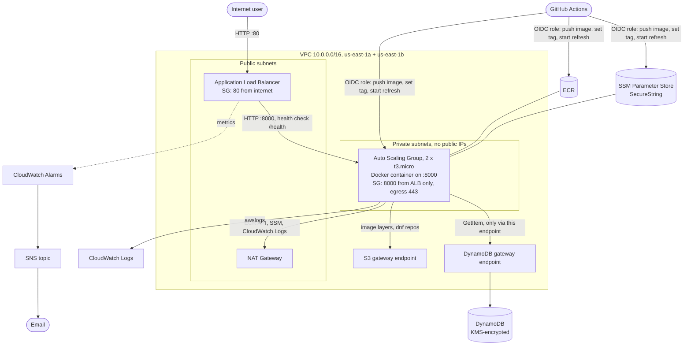

# Compie DevOps Home Assignment

A minimal FastAPI app, containerized with Docker and deployed to AWS with Terraform.
It runs on EC2 instances in an Auto Scaling Group in **private subnets**, behind a public
Application Load Balancer. It uses DynamoDB, ECR, SSM Parameter Store, CloudWatch
Logs and Alarms, and KMS encryption at rest. Every push to `main` is tested, built and rolled
out by GitHub Actions.

> **Status (2026-10-19):** deployed and verified end to end in us-east-1, see
> [Deployment evidence](#deployment-evidence). After the submission, the AWS environment
> was **destroyed** with the [teardown steps](#cost-and-teardown): both the main stack and
> the bootstrap stack (ECR and the state bucket). The ALB URL in the evidence no longer
> responds. To run it again, follow [Deploy to AWS](#deploy-to-aws).

> **Branch `feature/terraform-modules`:** a refactor of the submitted Terraform (branch `main`,
> commit `daa7677`) into reusable child modules, made after the submission. It has passed static
> checks and mocked tests only and has **not been deployed**. All live results in this README
> (evidence, policy simulator, fresh-clone plan) come from the original layout on `main`. See
> [Terraform structure: single root vs. modules](#terraform-structure-single-root-vs-modules).

## Contents

- [Architecture](#architecture)
- [Terraform structure: single root vs. modules](#terraform-structure-single-root-vs-modules)
- [Application and Docker](#application-and-docker)
- [Deploy to AWS](#deploy-to-aws)
- [CI/CD (GitHub Actions)](#cicd-github-actions)
- [Security and IAM](#security-and-iam)
- [Capacity and scaling](#capacity-and-scaling)
- [Logging, monitoring and alerting](#logging-monitoring-and-alerting)
- [Deployment evidence](#deployment-evidence)
- [Assignment requirements checklist](#assignment-requirements-checklist)
- [Troubleshooting](#troubleshooting)
- [Lessons learned](#lessons-learned)
- [Cost and teardown](#cost-and-teardown)
- [How AI assistance was used](#how-ai-assistance-was-used)

## Architecture



| Component | Responsibility |
|---|---|
| **ALB** (public subnets) | Only entry point from the internet. Forwards to instances on port 8000 and health-checks `/health`. |
| **Auto Scaling Group** (private subnets) | 2 instances, one per AZ. Replaces instances that fail the ALB health check, and rolls out new versions with instance refresh. |
| **Launch template + `user_data`** | Amazon Linux 2023, IMDSv2 only, encrypted gp3. At boot: installs Docker, reads config from SSM, pulls the image from ECR, runs the container with CloudWatch logging. |
| **NAT Gateway** (one) | Outbound HTTPS for the private instances (ECR API, SSM, CloudWatch Logs). |
| **S3 and DynamoDB gateway endpoints** (free) | Keep image layers, OS packages and database traffic on the AWS network. |
| **ECR** | Container registry with immutable tags (git SHA) and scan on push. |
| **SSM Parameter Store** | Welcome message and table name as SecureString (KMS), plus the deployed `image_tag`. |
| **DynamoDB** | Managed, private (IAM + VPC endpoint), on-demand, KMS-encrypted. |
| **CloudWatch Logs, Alarms + SNS** | Logs per instance; 3 alarms → SNS → email. |
| **GitHub Actions + OIDC** | Test → build → push → set tag → instance refresh → smoke test. No AWS keys stored in GitHub. |

### Repository layout

```
app/                     FastAPI app (main.py), tests, Dockerfile, requirements
docker-compose.yml       local stack: app + DynamoDB Local
terraform/bootstrap/     one-time: S3 state bucket + ECR repository (local state)
terraform/environments/dev/  main stack root (S3 backend, native locking): composes the modules
  versions.tf            providers, backend, default tags
  main.tf                naming locals, ECR lookup, the 7 module calls
terraform/modules/       reusable child modules (each: main.tf, variables.tf, outputs.tf, tests/)
  network/               VPC, subnets, IGW, NAT, routes, gateway endpoints
  security-groups/       ALB and app security groups (they reference each other)
  alb/                   ALB, target group, listener
  data/                  DynamoDB table + SSM app config parameters and image_tag
  compute/               log group, instance role, launch template, ASG, user_data.sh.tftpl
  monitoring/            SNS topic + CloudWatch alarms
  github-oidc/           GitHub OIDC provider + CI/CD role
.github/workflows/       CI/CD pipeline
evidence/                screenshots and redacted CLI output from the live deployment
```

## Terraform structure: single root vs. modules

The same infrastructure exists in two intentional layouts:

| | `main` (submitted) | `feature/terraform-modules` (this branch) |
|---|---|---|
| Layout | One root module, one `.tf` file per concern | Thin root per environment + 7 child modules |
| Status | Deployed, verified live, then destroyed | Static checks and mocked tests only, **never deployed** |
| Best for | One small environment, fast to read and explain | Several environments sharing one tested design |

### Why the submission used a single root module

The assignment asked for one environment. A flat root with files named by responsibility
(`network.tf`, `alb.tf`, `compute.tf`, ...) let every resource be found and explained in one
place, with no input/output plumbing. Modules would have added files and indirection without a
second consumer to justify them (KISS/YAGNI).

### Why this branch uses child modules

Modules start to pay off once a second environment or a second team needs the same design.
Each module has a small, documented contract (`variables.tf` in, `outputs.tf` out). It can be
tested on its own, and a change shows up in one place.

Modules are grouped **by purpose, not by resource type**. There is no `iam` module: the
instance role lives in `compute`, next to the instances that use it, because its policy needs
the log group and the launch template needs the role. Splitting them would make two modules
depend on each other. The CI/CD role has a different consumer, so it is its own module.

| Module | Responsibility | Inputs | Outputs |
|---|---|---|---|
| `network` | VPC, public/private subnets per AZ, IGW, one NAT, routes, S3 + DynamoDB gateway endpoints | `name`, `region`, `vpc_cidr`, `az_count` (2) | `vpc_id`, `public_subnet_ids`, `private_subnet_ids`, `dynamodb_endpoint_id` |
| `security-groups` | internet → ALB :80 → app :8000, app egress 443 only | `name`, `vpc_id`, `app_port` | `alb_security_group_id`, `app_security_group_id` |
| `alb` | Public ALB, target group with `/health` check, listener | `name`, `vpc_id`, `public_subnet_ids`, `security_group_id`, `app_port`, `health_check_path` | `dns_name`, `target_group_arn`, `lb_arn_suffix`, `target_group_arn_suffix` |
| `data` | DynamoDB table, SSM parameters (`welcome_message`, `table_name`, `image_tag`) | `name`, `param_path`, `welcome_message`, `image_tag` | `table_name`, `table_arn`, `param_path`, `image_tag_parameter_arn` |
| `compute` | Log group, instance role, launch template (`user_data.sh.tftpl`), ASG | `name`, `region`, subnets, SG, target group, size (2/2/4), ECR, `param_path`, `log_group_name`, table ARN, endpoint id | `asg_name`, `asg_arn`, `log_group_name` |
| `monitoring` | SNS topic, optional email subscription, 3 ALB alarms | `name`, `alert_email`, `lb_arn_suffix`, `target_group_arn_suffix` | `alerts_topic_arn` |
| `github-oidc` | GitHub OIDC provider, CI/CD role scoped to ECR, `image_tag`, the ASG | `name`, `github_repository`, ECR ARN, `image_tag_parameter_arn`, `asg_arn` | `role_arn` |

### How the modules communicate

A module never reads another module's resources. The root passes one module's outputs into the
next module's inputs, and Terraform builds the dependency graph from those references.
For example, in [`environments/dev/main.tf`](terraform/environments/dev/main.tf):

```hcl
module "alb" {
  source            = "../../modules/alb"
  public_subnet_ids = module.network.public_subnet_ids                 # output of network
  security_group_id = module.security_groups.alb_security_group_id     # output of security-groups
  ...
}

module "compute" {
  source           = "../../modules/compute"
  target_group_arn = module.alb.target_group_arn   # instances register behind the ALB
  param_path       = module.data.param_path        # waits for the SSM parameters, see below
  ...
}
```

Values flow one way: network → security-groups → alb → compute → github-oidc, with `data` and
`monitoring` alongside. There are no cycles. The two security groups reference each other, so
they stay inside one module, as separate rule resources.

One dependency is not visible in any attribute: instances read SSM at boot. The original ASG had
`depends_on` on the parameters. Across a module boundary this became an **output with
`depends_on`**: `data.param_path` is only known once all three parameters exist, and
`compute` uses it in `user_data`.

**Reading `environments/dev/main.tf`:**
1. `locals` builds the naming once: `compie-app-dev`, `/compie-app/dev` and port 8000.
2. A `data` block looks up the ECR repository created by the bootstrap stack.
3. Seven `module` blocks follow, in dependency order. Each argument is either a root
   variable/local or another module's output (`module.<name>.<output>`).
4. `outputs.tf` re-exports what operators and CI need (`alb_url`, `asg_name`, `ci_role_arn`, ...).

### Adding an environment (staging, prod)

A new environment is a new root directory. The modules stay unchanged:

```
terraform/environments/staging/
  versions.tf   backend key = "staging/terraform.tfstate" (its own state file)
  main.tf       the same module calls (copied from dev)
  terraform.tfvars   environment = "staging", vpc_cidr, instance_type, alert_email, ...
```

Names, SSM paths and log groups are derived from `project` and `environment`, so they do not
collide. **What would still need to change first:**

- **GitHub OIDC provider.** An AWS account can hold only one provider per URL. A second
  environment in the same account must look it up instead of creating it (for example, a
  `create_oidc_provider` flag on the module), or each environment needs its own account.
- **CI/CD.** The workflow deploys only to dev: the ASG, ALB and parameter names are fixed in
  `deploy.yml`, and the CI role trusts only `refs/heads/main`. Staging and prod need their own
  roles, trust conditions (for example GitHub environments or tags) and promotion steps.
- **Shared bootstrap.** Every environment would share one ECR repository and one state bucket,
  and the bootstrap stack keeps local state.
- **Module versions.** Modules are referenced by relative path, so every environment changes
  as soon as a module changes. Pinned versions (git tags or a registry) would let prod lag
  behind staging.

### Before real production use

Being modular does not make this production-ready. Still missing, among others:

- HTTPS (ACM certificate, redirect from HTTP to HTTPS) and a WAF.
- One NAT gateway per AZ instead of one.
- Target-tracking scaling policies.
- DynamoDB point-in-time recovery and deletion protection.
- Alerts routed to a paging tool instead of email.
- `terraform plan` in pull requests, with policy checks (tflint, checkov or similar).
- Separate AWS accounts per environment.
- A tested rollback procedure.

### Migrating an existing deployment

Every address gains a module prefix, for example `aws_vpc.main` becomes
`module.network.aws_vpc.main`. Against an existing state without migration, `plan` would replace
all 44 resources. A migration would add one `moved` block per resource in
`environments/dev` (the backend key is unchanged, so the state file is the same) and require a
`plan` with **0 changes** before any apply:

```hcl
moved {
  from = aws_subnet.private               # moves every count instance
  to   = module.network.aws_subnet.private
}
```

None are included, because the environment was destroyed: a fresh apply needs no migration.

### Checks performed on this branch (2026-10-20)

All checks are offline. Nothing was planned or applied against AWS.

| Check | Result |
|---|---|
| `terraform fmt -check -recursive` | clean |
| `terraform init -backend=false` + `terraform validate`, dev root and each module on its own | all valid |
| `tflint` 0.59 with every built-in rule (`preset = "all"`) and the AWS ruleset, root and modules | no issues |
| `terraform test` with `mock_provider "aws"`, AWS credentials disabled | 16/16 runs pass (7 module test files + 1 composition test) |
| Mutation check: IMDSv2 set to `optional` in a copy | compute test fails as intended |
| `user_data` rendered from `daa7677` and from this branch with the same values | byte-identical |
| Resource and data blocks, old vs new (type + name) | same 44 blocks (40 resources, 4 data sources) |
| Each block's body, old vs new (comments ignored) | only reference rewrites (for example `local.name` becomes `var.name`); no setting changed |

**Not covered:** behaviour in AWS. The mocks do not catch API-side errors such as invalid IAM
JSON or name limits, and the policy simulator checks were not repeated. A real `plan` and `apply`
in a sandbox account would be the next step.

Run the tests locally (no AWS credentials needed):

```bash
for d in terraform/modules/* terraform/environments/dev; do
  terraform -chdir=$d init -backend=false && terraform -chdir=$d test
done
```

## Application and Docker

| Path | Purpose | Response |
|---|---|---|
| `/` | App name, deployed version (git SHA), welcome message, status | `200` |
| `/health` | **Liveness.** No dependencies. Used by the ALB and the Docker `HEALTHCHECK`. | `200 {"status":"ok"}` |
| `/ready` | **Readiness.** A real DynamoDB `GetItem`. | `200`, or `503` when the database is unreachable |

**Why two health endpoints.** If the ALB health check depended on DynamoDB, one database
problem would mark every instance unhealthy and the ASG would keep replacing healthy
instances, turning a dependency outage into a full outage. `/ready` reports the
database instead, and the 5xx alarm watches it.

**What `/ready` proves.** It calls `GetItem` on the key `pk = "healthcheck"`; the item does not
need to exist. Success shows that:

- the DynamoDB endpoint is reachable,
- the request was signed with valid credentials,
- IAM allows `GetItem` on the table,
- the table exists and serves reads.

It does **not** prove write permissions or direct `kms:Decrypt` rights, because DynamoDB
decrypts server-side. Errors are logged; the response stays generic.

**Configuration** comes only from environment variables. In AWS, the boot script reads
them from SSM.

| Variable | Required | Source in AWS |
|---|---|---|
| `WELCOME_MESSAGE` | yes | SSM `/compie-app/dev/welcome_message` (SecureString) |
| `DYNAMODB_TABLE_NAME` | yes | SSM `/compie-app/dev/table_name` (SecureString) |
| `AWS_REGION` | yes | boot script |
| `APP_NAME` | no | default `compie-app` |
| `APP_VERSION` | no | baked into the image at build time (git SHA). It is build metadata, not config. |
| `DYNAMODB_ENDPOINT_URL` | no | local only (DynamoDB Local) |

**Dockerfile practices:**

- `python:3.12-slim` base.
- Dependencies installed before the code is copied, so that layer stays cached.
- `--no-cache-dir`.
- Non-root user (UID 10001, no login shell); code is root-owned and read-only.
- `PYTHONUNBUFFERED` so logs reach CloudWatch immediately.
- Exec-form `CMD` so uvicorn is PID 1 and receives SIGTERM.
- `HEALTHCHECK` on `/health`.
- Allow-list `.dockerignore`.
- Final image size: 161 MB.

### Run and test locally

```bash
docker compose up --build -d      # app + DynamoDB Local + one-shot table creation
curl localhost:8000/ ; curl localhost:8000/health ; curl localhost:8000/ready
docker compose stop dynamodb-local
curl -i localhost:8000/ready      # 503: real connection failure
curl -i localhost:8000/health     # still 200
docker compose down
```

Unit tests run in the same Python version as the image. On Git Bash for Windows, prefix
the command with `MSYS_NO_PATHCONV=1`.

```bash
docker run --rm -v "$PWD/app:/src:ro" -w /src python:3.12-slim \
  sh -c "pip install -q -r requirements-dev.txt && pytest -v -p no:cacheprovider"
```

There are 10 tests: `/`, `/health`, `/ready` against mocked DynamoDB (moto), and the failure
cases: missing table, unreachable endpoint (a real connection refusal), and missing
configuration.

## Deploy to AWS

Prerequisites: Terraform >= 1.10, AWS CLI v2, Docker, and an admin AWS profile for
provisioning (region `us-east-1`).

There are two stacks, applied in order, so `-target` is never needed. The bootstrap stack
creates ECR, so the first image exists before the Auto Scaling Group launches.

```bash
# 1. Bootstrap (one time): S3 state bucket + ECR repository
terraform -chdir=terraform/bootstrap init
terraform -chdir=terraform/bootstrap apply

# 2. Push the first image, tagged with the git SHA
REPO=$(terraform -chdir=terraform/bootstrap output -raw ecr_repository_url)
TAG=$(git rev-parse --short HEAD)
aws ecr get-login-password --region us-east-1 | docker login --username AWS --password-stdin "${REPO%%/*}"
docker build --build-arg APP_VERSION="$TAG" -t "$REPO:$TAG" app && docker push "$REPO:$TAG"

# 3. Main stack (44 resources, about 5 minutes)
#    The state bucket is named compie-app-tfstate-<account-id>.
terraform -chdir=terraform/environments/dev init -backend-config="bucket=$(terraform -chdir=terraform/bootstrap output -raw state_bucket)"
terraform -chdir=terraform/environments/dev apply -var="image_tag=$TAG" -var="alert_email=you@example.com"
terraform -chdir=terraform/environments/dev output alb_url
```

- **Bootstrap state is local.** `terraform/bootstrap/terraform.tfstate` is gitignored and
  exists only on the machine that ran the bootstrap, so `terraform output` for that stack
  works only there. In a fresh clone it prints nothing. On another machine, pass the
  bucket name directly, `-backend-config="bucket=compie-app-tfstate-<account-id>"`, and
  take the ECR URL from `aws ecr describe-repositories --repository-names compie-app`.
  On the original flat layout (`main`), this path was checked read-only from a fresh clone:
  `init` succeeded, and `plan` reported "No changes". The modular layout on this branch has
  not been planned against AWS.
- **Health checks:** instances become healthy in the target group about 2–5 minutes after
  apply (the ASG health check grace period is 300s).
- **`image_tag`** is used only on the first apply. Afterwards the pipeline owns the SSM
  parameter, and Terraform ignores changes to its value.
- **Pass `alert_email` on every apply.** Omitting it makes Terraform plan to delete the
  subscription.

## CI/CD (GitHub Actions)

Workflow: [`.github/workflows/deploy.yml`](.github/workflows/deploy.yml).

| Trigger | Runs |
|---|---|
| Pull request | `test` job only (pre-merge check) |
| Push to `main` | `test`, then `deploy` to `dev` |
| Manual (`workflow_dispatch`) | `test`, then `deploy` to `dev` |

`deploy` steps:

1. **AWS login via OIDC.** GitHub holds no AWS keys. The role trusts only the `main` branch
   of this repository. GitHub's `sub` claim uses immutable IDs:
   `repo:AmirWeiser@123477471/compie-devops-assignment@1424430511:ref:refs/heads/main`.
   That also blocks a deleted-and-recreated repo with the same name.
2. **Build and push** `compie-app:<short git SHA>` to ECR, with
   `--build-arg APP_VERSION=<sha>`. Tags are immutable; a re-run reuses the existing image.
3. **Set the image tag** in SSM `/compie-app/dev/image_tag`.
4. **Instance refresh** with `MinHealthyPercentage=100`, `MaxHealthyPercentage=200`, and
   `SkipMatching=false`.
   - The preferences ask the ASG to launch replacements first (up to 200%) and to keep
     100% of desired capacity healthy, so old instances are terminated only after their
     replacements pass the health check and warm-up. This **reduces** the risk of
     downtime but does not guarantee it. In-flight requests on a draining instance
     (30s deregistration delay) or a replacement that never becomes healthy can still
     cause errors; in that case the refresh stalls instead of removing healthy
     instances.
   - **Observed:** two refreshes completed with 0 ALB or target 5xx responses. The only
     traffic during them was the smoke tests, so this was **not** a load test.
   - Each new instance reads the tag from SSM at boot.
   - Every instance is replaced even though the launch template has not changed.
   - The job polls until the refresh reports `Successful`. A `concurrency` group prevents
     overlapping refreshes.
5. **Smoke test** through the ALB: `/health`, `/ready` and `/`, then 6 consecutive requests
   to `/` must all return the version just deployed. That is a strong sample across both
   targets, not a per-instance proof. Per-instance checks are in
   [`evidence/cli/05`](evidence/cli/05-aws-instances-running-image.txt).

**One-time setup:** create a repository **variable** (not a secret) `AWS_ROLE_ARN` with the
`ci_role_arn` Terraform output.

### Rollback (documented, not tested)

> **Neither rollback path below has been exercised in this project.** Both follow from
> how the pipeline works, but treat them as documented procedures, not verified ones.

`workflow_dispatch` always deploys the **current head of `main`**. It cannot select an
arbitrary older commit. The two options are:

1. **Revert in git (preferred).** `git revert <bad-commit>` and push to `main`. The
   pipeline tests, builds and deploys the reverted code as a new version, and history
   records what happened.
2. **Point the tag back at an image already in ECR.** This is faster, with no rebuild.
   It is a manual step run by an operator with their own AWS credentials, not by the
   pipeline. The image must still exist in ECR; the lifecycle policy keeps the last 10.

   ```bash
   aws ecr describe-images --repository-name compie-app --image-ids imageTag=<previous-sha>   # must exist
   aws ssm put-parameter --name /compie-app/dev/image_tag --value <previous-sha> --overwrite
   aws autoscaling start-instance-refresh --auto-scaling-group-name compie-app-dev \
     --preferences '{"MinHealthyPercentage":100,"MaxHealthyPercentage":200,"SkipMatching":false}'
   ```

   Note that the next push to `main` deploys the head of `main` again.

ASG **AutoRollback** is not available here. AWS supports it only when the refresh changes
the launch template, and our image version lives in SSM.

## Security and IAM

**Private compute and least-privilege networking:**

| Security group | Inbound | Outbound |
|---|---|---|
| `alb` | TCP 80 from `0.0.0.0/0` | TCP 8000 to the `app` SG only |
| `app` | TCP 8000 from the `alb` SG only | TCP 443 only (AWS APIs and packages) |

- Instances have **no public IPs** and **no SSH**. Shell access goes through SSM Session
  Manager.
- AWS's default allow-all outbound rule is removed.

**IAM is split by responsibility:**

| Identity | Can | Cannot |
|---|---|---|
| **EC2 instance role** | Pull from the `compie-app` ECR repo; read app config (our policy scopes `ssm:GetParameter` to `/compie-app/dev/*`, but the AWS-managed SSM policy widens the **effective** read access; see the trade-off below); write to the app log group; SSM agent; `dynamodb:GetItem` on the app table **only through the VPC endpoint** (`aws:SourceVpce`) | Write to DynamoDB, scan, change parameters, push images |
| **CI/CD role** (GitHub OIDC) | Push to the `compie-app` ECR repo; `ssm:PutParameter` on `image_tag` only; `StartInstanceRefresh` on this ASG; describe refreshes and load balancers | **Read app config**, `kms:Decrypt`, DynamoDB, other repos |
| **Terraform operator** | Admin, used only from the operator's workstation | — |

These were verified live and with the IAM policy simulator; see
[`evidence/cli/`](evidence/cli). A leaked instance credential cannot read the table from
outside the VPC: the simulator returns `implicitDeny` without the endpoint context.

**Encryption at rest (AWS-managed KMS keys):**

- DynamoDB: `aws/dynamodb`.
- SSM SecureString: `aws/ssm`.
- EBS: `aws/ebs`.
- State bucket: SSE-S3, with versioning, all public access blocked, and
  `force_destroy = false` to protect state history.

**Secrets:** none in the repo or the image. Config lives in SSM. The alert email is passed
at apply time, not committed.

**Known trade-offs:**

- **SSM read access is broader than our own policy suggests.** The instance role has
  the AWS-managed policy `AmazonSSMManagedInstanceCore` (v2), which the SSM agent needs.
  It grants `ssm:GetParameter` and `ssm:GetParameters` on `Resource: "*"`, plus agent
  actions (`ssmmessages:*`, `ec2messages:*`, `ssm:UpdateInstanceInformation`, ...).
  - **Effect:** the instances can read **any** SSM parameter in the account, not only
    `/compie-app/dev/*`. That includes SecureStrings encrypted with the AWS-managed
    `aws/ssm` key, whose key policy allows decryption through SSM for principals in the
    account.
  - **Not affected:** `ssm:GetParametersByPath` is not granted, and SecureStrings under a
    customer-managed key would still need `kms:Decrypt`.
  - **Verified with the policy simulator:** `GetParameter` on an unrelated parameter is
    `allowed`, matched by `AmazonSSMManagedInstanceCore`.
  - **Accepted for this assignment:** at review time the only SSM parameters in
    us-east-1 were this app's three, and us-east-2, us-west-2 and eu-west-1 had none.
  - **Fix for production:** replace the managed policy with a custom agent policy that
    includes only the `ssmmessages`/`ec2messages`/`UpdateInstanceInformation` actions,
    keeping our path-scoped `GetParameter`. Separately, use a customer-managed KMS key for
    SecureStrings.
- The ALB serves HTTP only; HTTPS needs a domain and an ACM certificate.
- The SNS topic is unencrypted, because CloudWatch can publish only to topics encrypted
  with a customer-managed key, and alerts contain no sensitive data.

## Capacity and scaling

- **Now:** `min 2 / desired 2 / max 4`, one instance per AZ. `max 4` leaves room for the
  200% rolling deploy.
- **What this tolerates (by design; failure scenarios were not tested):**
  - **Losing one instance:** the ALB keeps serving from the other while the ASG replaces
    it. Capacity is halved meanwhile.
  - **Losing us-east-1b:** the instance in us-east-1a keeps serving, and the ASG can launch
    replacements.
  - **Losing us-east-1a**, where the single NAT Gateway lives: the instance in us-east-1b
    keeps serving existing traffic, but **new instances cannot boot**. They need the NAT
    to reach the ECR API and SSM. So the service runs at reduced capacity with no
    self-healing until the AZ recovers. Fixing this needs one NAT per AZ or interface
    endpoints.
- **Self-healing:** ELB health checks with a 300s grace period. An instance failing
  `/health` is replaced automatically.
- **How I would scale:**
  - Add a target-tracking policy (average CPU 50%, or ALB requests per target) between min
    and max.
  - Raise `max_size` for peaks.
  - Use a larger instance type if a single request needs more CPU or memory.
  - The app is stateless and DynamoDB is on-demand, so horizontal scaling needs no code
    change.
- **For production:** one NAT per AZ (or interface endpoints) instead of the single NAT
  Gateway, which is a cost trade-off. Also a baked AMI to cut boot time, which is about
  80s, mostly the Docker install.

## Logging, monitoring and alerting

**Logs:** container stdout/stderr goes through the Docker `awslogs` driver to the CloudWatch
log group `/compie-app/dev`. There is **one log stream per EC2 instance ID**, with 7-day
retention. Uvicorn access logs show the real client IP (`FORWARDED_ALLOW_IPS`). Boot
progress (`user-data:` lines) is visible in the EC2 console output without SSH.

**Alarms** (`terraform/modules/monitoring`):

| Alarm | Metric | Fires when | Why |
|---|---|---|---|
| `compie-app-dev-unhealthy-hosts` | `UnHealthyHostCount` (max) | > 0 for 3 consecutive minutes | An instance fails `/health` (boot failure, crashed container, bad image). 3 minutes so a deploy blip does not page. |
| `compie-app-dev-no-healthy-hosts` | `HealthyHostCount` (min) | < 1 for 2 minutes; missing data = breaching | The service is down for users. |
| `compie-app-dev-target-5xx` | `HTTPCode_Target_5XX_Count` (sum) | >= 5 in 5 minutes | Server errors, including `/ready` 503s, so this is also the DynamoDB connectivity signal. |

**Notification flow:** CloudWatch alarm → SNS topic `compie-app-dev-alerts` → email. Both
`ALARM` and `OK` transitions are sent, so you also get "recovered" messages.

- **Real setup:** the topic would also feed the on-call tool: PagerDuty or Opsgenie through
  an HTTPS subscription, or Slack through AWS Chatbot.
- **Test the wiring safely:** this changes only the alarm state, which returns at the next
  evaluation.

  ```bash
  aws cloudwatch set-alarm-state --alarm-name compie-app-dev-unhealthy-hosts \
    --state-value ALARM --state-reason "Manual test of alert wiring"
  ```

## Deployment evidence

All of this was captured from the live environment on 2026-10-19. Screenshots are real
browser captures. CLI evidence is read-only output with the account ID, the alert email
and client IPs redacted.

**Workflow runs:**

| Run | Commit | Result | Notes |
|---|---|---|---|
| [#1](https://github.com/AmirWeiser/compie-devops-assignment/actions/runs/39223860793) | `9851d3b` | ❌ deploy failed at AWS login | OIDC `sub` format mismatch; see [Lessons learned](#lessons-learned) |
| [#2](https://github.com/AmirWeiser/compie-devops-assignment/actions/runs/39224324049) | `33657ed` | ✅ 7m54s | First automated deployment after the trust-policy fix |
| [#3](https://github.com/AmirWeiser/compie-devops-assignment/actions/runs/39227466875) | `78dc9e1` | ✅ 7m40s | App change: `/` reports the version; the smoke test checks it |

**Instance refreshes:** `2b22df50…` Successful in 6m40s, and `0da3a977…` Successful in
6m28s. Both refreshes replaced both instances, with no 5xx responses from the ALB or the
targets and no alarm transitions during the rollouts. (Only the smoke tests sent traffic
then.)

**ECR images:** `45cc857` (manual bootstrap push), `33657ed` and `78dc9e1` (pushed by CI).
After run #3, both instances were running `compie-app:78dc9e1` with
`APP_VERSION=78dc9e1`, checked with `docker ps` on each instance through SSM.

**Alert test:** `SetAlarmState` → `ALARM` at 08:23:08 UTC → back to `OK` at 08:23:48. Both
SNS actions succeeded; SNS delivered 2 messages with 0 failed.

| Screenshot | Shows |
|---|---|
| [01-app-root-live-alb.png](evidence/screenshots/01-app-root-live-alb.png) | Live app through the public ALB, version `78dc9e1` |
| [02-app-health-live-alb.png](evidence/screenshots/02-app-health-live-alb.png) | `/health` through the ALB |
| [03-app-ready-live-alb.png](evidence/screenshots/03-app-ready-live-alb.png) | `/ready` through the ALB: DynamoDB reachable |
| [04-local-docker-root.png](evidence/screenshots/04-local-docker-root.png) | Image running locally: `/` |
| [05-local-docker-health.png](evidence/screenshots/05-local-docker-health.png) | Image running locally: `/health` |
| [10-github-actions-run3-success.png](evidence/screenshots/10-github-actions-run3-success.png) | Run #3: test + deploy succeeded |
| [14-github-actions-run2-success.png](evidence/screenshots/14-github-actions-run2-success.png) | Run #2: first successful deployment |
| [15-github-actions-run1-oidc-failure.png](evidence/screenshots/15-github-actions-run1-oidc-failure.png) | Run #1: the OIDC failure, kept for transparency |
| [12-github-commit-history.png](evidence/screenshots/12-github-commit-history.png) | Commit history |
| [13-github-repository.png](evidence/screenshots/13-github-repository.png) | Repository |

| CLI evidence | Shows |
|---|---|
| [01-local-docker-run.txt](evidence/cli/01-local-docker-run.txt) | Local run, non-root user, image size, `/ready` 503 during a simulated DB outage while `/health` stays 200 |
| [02-aws-network.txt](evidence/cli/02-aws-network.txt) | Subnets, NAT, routes, gateway endpoints, security group rules |
| [03-aws-compute-alb-asg.txt](evidence/cli/03-aws-compute-alb-asg.txt) | ASG sizing; 2 instances in 2 AZs with private IPs, no public IPs and IMDSv2; healthy targets; instance refreshes |
| [04-aws-ecr-ssm-dynamodb.txt](evidence/cli/04-aws-ecr-ssm-dynamodb.txt) | ECR image tags; SSM parameter **names** (no values); DynamoDB SSE (KMS) |
| [05-aws-instances-running-image.txt](evidence/cli/05-aws-instances-running-image.txt) | Image and version running on each instance |
| [06-aws-cloudwatch-logs.txt](evidence/cli/06-aws-cloudwatch-logs.txt) | Application logs from both instance streams |
| [07-aws-alerting.txt](evidence/cli/07-aws-alerting.txt) | SNS topic and confirmed subscription, alarm configuration, the `SetAlarmState` test |

## Assignment requirements checklist

| Requirement | Where |
|---|---|
| Minimal app exposing `/` and `GET /health` | `app/main.py`; screenshots 01–02 |
| Dockerfile; image runs locally and `/`, `/health` work | `app/Dockerfile`, `docker-compose.yml`; screenshots 04–05, `cli/01` |
| VPC with public and private subnets | `modules/network`; `cli/02` |
| EC2 in an ASG in private subnets, no public IPs | `modules/compute`; `cli/03` |
| Public ALB in front of the ASG | `modules/alb`; screenshots 01–03 |
| Launch template, target group, health checks, sensible min/desired/max | `modules/compute`, `modules/alb` |
| README explains capacity and scaling | [Capacity and scaling](#capacity-and-scaling) |
| No ECS or EKS | EC2 + Docker only |
| Least-privilege security groups | `modules/security-groups`; [Security and IAM](#security-and-iam) |
| Image in ECR | `terraform/bootstrap`; `cli/04` |
| Config outside the image, in a managed store, consumed by the service | `modules/data`, `modules/compute/user_data.sh.tftpl` |
| Instance profile: ECR pull, read config, write logs, SSM | `modules/compute` (instance role) |
| CI/CD identity: push to ECR and trigger rollout, cannot read secrets | `modules/github-oidc` (verified with the policy simulator) |
| No oversized admin identity | Separate instance and CI roles |
| Managed, private DB; no hardcoded credentials | `modules/data`, `modules/compute` (IAM + VPC endpoint condition) |
| App proves DB connectivity | `/ready`; screenshot 03 |
| Logs in CloudWatch | `modules/compute`, `user_data`; `cli/06` |
| KMS at rest for the DB and the config store | DynamoDB `aws/dynamodb`, SSM `aws/ssm` (plus EBS) |
| Alarms on service state, sent to an endpoint, documented | `modules/monitoring`; `cli/07`; [Alerting](#logging-monitoring-and-alerting) |
| `terraform apply` (+ documented bootstrap) gives a working URL | [Deploy to AWS](#deploy-to-aws) |
| Pipeline builds, pushes to ECR and deploys to `dev` with no console steps | `deploy.yml`; runs #2 and #3 |
| Release trigger documented | [CI/CD](#cicd-github-actions) |
| No secrets in the zip | `.gitignore`; checked before each commit |
| Browser screenshot of the live app | `evidence/screenshots/01–03` |
| Bonus: architecture diagram, AI notes, encrypted EBS | Done |
| Bonus: PR / pre-merge checks | Configured (`test` job runs on `pull_request`), not yet exercised with a real PR |
| Bonus: dashboard, customer-managed KMS key, HTTPS, scaling policy, second environment | Not done (out of scope by choice) |

## Troubleshooting

| Symptom | Likely cause | Check |
|---|---|---|
| Targets `unhealthy`, instances replaced repeatedly | Boot script failed (Docker install, SSM read, ECR pull) | `aws ec2 get-console-output --instance-id <id> --latest --output text \| grep user-data:` shows each step and the failing line. Or `aws ssm start-session --target <id>`, then `sudo cat /var/log/cloud-init-output.log`. |
| Instances never appear in SSM | No outbound path | NAT state; private route `0.0.0.0/0 → NAT`; app SG egress 443 |
| `/ready` returns 503 | IAM, the endpoint condition, or the table | The log stream shows the boto error (`AccessDenied`, `ResourceNotFound`, ...) |
| `/ready` AccessDenied | Request did not go through the DynamoDB gateway endpoint | Private route table has the DynamoDB prefix-list route |
| Container cannot get credentials | IMDS hop limit | Launch template `http_put_response_hop_limit = 2` |
| ALB returns 502/503 | No healthy targets | Target health; the app must listen on port 8000 |
| Pipeline: `Not authorized to perform sts:AssumeRoleWithWebIdentity` | OIDC trust mismatch | CloudTrail `AssumeRoleWithWebIdentity` events show the exact `sub` claim GitHub sent; it must match `github_repository` in `environments/dev/variables.tf`. Also: the workflow runs on `main`, `AWS_ROLE_ARN` is set, and there is no `environment:` key in the job. |
| Pipeline: `InstanceRefreshInProgress` | A refresh is already running | Wait, or `aws autoscaling describe-instance-refreshes` |

## Lessons learned

1. **GitHub's OIDC `sub` claim uses immutable IDs.**
   - **What happened:** the first pipeline run failed to assume the role. CloudTrail
     showed the real claim: `repo:Owner@<id>/repo@<id>:ref:...`, not `repo:Owner/repo:...`.
   - **Fix:** the trust policy now matches the exact claim.
   - **Lesson:** debug from the provider's own audit log, not from assumptions.
2. **A just-created NAT Gateway can be briefly unreliable.**
   - **What happened:** on the very first apply, outbound HTTPS through the brand-new NAT
     timed out for a few minutes. One instance's boot took about 240s, overran the 180s
     grace period, and was replaced. Later boots take about 80s.
   - **Fix:** a 300s grace period, plus retries in `user_data`.
   - **Diagnosis:** the `user-data:` lines in the console output.
3. **Bash: never log to stdout inside a function used in `$(...)`.** Retry messages would
   become part of the captured value. Writing the log to stderr fixed it; a local test with
   a stubbed `aws` CLI caught it before deployment.
4. **`environment:` in a GitHub job changes the OIDC `sub` claim** to
   `...:environment:<name>`. That would break a branch-based trust policy, so the deploy job
   doesn't set it.
5. **Separate liveness from readiness.** This keeps a database incident from becoming an
   instance-replacement storm.

## Cost and teardown

Approximate us-east-1 cost while the main stack runs:

| Resource | Per day |
|---|---|
| NAT Gateway + Elastic IP | ~$1.20 |
| ALB + 2 public IPv4 | ~$0.80 |
| 2 × t3.micro + 2 × 8 GB gp3 | ~$0.55 |
| DynamoDB on-demand, SSM, CloudWatch Logs and alarms, ECR, S3 | cents |
| **Total** | **~$2.5/day** |

**Teardown:**

```bash
# All hourly-billed resources (NAT, ALB, EC2, ...):
terraform -chdir=terraform/environments/dev destroy -var="image_tag=unused" -var="alert_email=you@example.com"
```

To also remove the bootstrap stack (ECR and the state bucket, cents per month):

1. Empty the state bucket, including **all object versions**. It has
   `force_destroy = false` on purpose.
2. Run `terraform -chdir=terraform/bootstrap destroy`. ECR has `force_delete = true`, so its
   images are removed too.

**Teardown done (2026-10-19):** main stack 44/44 resources destroyed, bootstrap stack 6/6
(after emptying all 41 state object versions). Read-only AWS CLI checks then found no
project resources left: no NAT gateway, load balancer, EC2 instance, EBS volume, Elastic IP,
VPC, ECR repository, S3 bucket, DynamoDB table, SSM parameter, log group, alarm, SNS topic
or IAM role/OIDC provider.

## How AI assistance was used

The PDF encourages AI use, so here is how this project was built.

**Tool:** Claude Code (Anthropic), used as a pair engineer in the terminal.

**What the AI did:**

- Read the assignment PDF and proposed a staged plan.
- Wrote the application, Dockerfile, Terraform, workflow and README.
- Ran local tests and linters (pytest, `terraform validate`, actionlint, shellcheck).
- Ran `terraform plan` and, after approval, `apply`.
- Investigated failures through CloudTrail, the EC2 console output and SSM Run Command.
- Collected the evidence in `evidence/`.

**What I controlled:** I set rules up front. The AI worked in small stages, explained each
stage before building it, and waited for my explicit approval before:

- any implementation step,
- any `terraform apply` or `destroy`,
- any git commit or push.

Plans were reviewed resource by resource before every apply.

**Decisions I made or changed:**

- Split `/health` (liveness) from `/ready` (readiness) instead of one DB-coupled health check.
- Required the AI to state precisely what a DynamoDB `GetItem` does and does not prove
  (no claim about KMS permissions).
- Imposed a strict simplicity rule, which cut the first app version from four modules to
  one file and removed speculative features.
- One NAT Gateway plus gateway endpoints; AWS-managed KMS keys; ECR in the bootstrap stack
  instead of `-target`; `force_destroy = false` on the state bucket.
- Tore the network down overnight to avoid cost, and redeployed the next day.

**Verification over trust:** nothing was reported as working until it was checked on the
running system. That means target health, `docker ps` on each instance, IAM checks (live
allowed/denied calls and the policy simulator), the alarm-to-SNS test, and the ALB serving
the deployed version. The failures above were found this way and fixed, not hidden.
